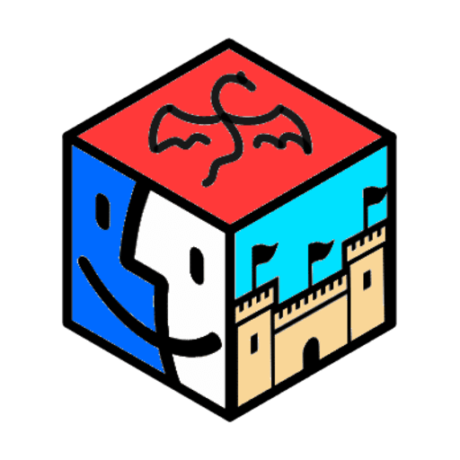

# RPG-Maker-MacOS-Launcher

RPG Maker製のゲームを**macOSのApple Silicon（native arm64）専用**で動かすためのランチャーです。ゲーム制作ツールではなく、実行環境の導入・設定・ゲームの起動・書き出しを扱います。MV・MZにはNW.js、XP・VX・VX AceにはMKXP-Z、2000・2003にはEasyRPGを使います。すべてのゲームやプラグインでの動作を保証するものではありません。

[m5kro/RPG-Maker-MacOS-Launcher](https://github.com/m5kro/RPG-Maker-MacOS-Launcher)から派生し、安全性の見直しとGo移行を進めているforkです。上流の「開発完了」という案内はこのforkの作業完了を意味しません。上流が紹介する後継は[Xenolauncher](https://github.com/m5kro/Xenolauncher)です。

現在は**Go backend + Wails v3.1.0 + macOS標準WebKit（WKWebView）**で動作します。画面はplain HTML/CSS/JavaScriptで、Python・PySide/Qt・pip・venv・PyInstallerは使いません。Node/npm/npx・TypeScript・Wails CLIも通常の開発・ビルド・受入に不要です。NW.jsが内蔵するNodeはゲーム用ランタイムの一部であり、開発用Node CLIとは別です。Go移行でゲーム用ランタイムが不要になるわけではありません。

> [!WARNING]
> 配布用のDeveloper ID署名・公証、Finder/Gatekeeper経由の起動は未検証です。検証したNW.jsにはリソースの署名封印がなく、strict `codesign`検証は失敗します。このホストで起動できても別のMacでの安全な配布を証明しません。OSが拒否した場合は保護機能を無効にせず、エラーを保持してください。

## 機能と安全上の境界

GUIはGoの共通backendを直接呼びます。別プロセスのPython/helperへのフォールバックはありません。NW.jsの公開版取得・導入、MKXP-Z/EasyRPG/RTP/SoundFont/Kawarikiの管理、詳細設定、ゲーム判定・起動・パッチ・書き出しをGoに移しています。詳細設定は既存JSONの型・未知キー・Force/read-only項目を保ち、明示的なResetだけ初期値の型に戻します。

- **Intel Mac・Rosettaは非対応。** ホスト検査は管理データ変更前に行います。NW.jsは公式macOS arm64配布のある版だけ表示し、x64への切替はしません。
- NW.jsは公式`SHASUMS256.txt`とアーカイブSHA-256を照合してから専用stageへ展開します。主実行ファイルのMach-Oを検査し、破損・Intel-only・旧x64 receipt・Rosetta marker付きの版は起動／書き出し前に拒否します。旧データを自動削除しません。
- 同じ版の導入済みruntimeは再検証し、一致すれば再downloadなしで完了します。不完全な同名ディレクトリや旧ランチャーのreceiptなし導入を勝手に上書きしません。GUIは返却path・receipt・再検出を確認した後だけ選択を保存し、一覧更新失敗も成功表示しません。
- MKXP-Zの`Z-universal.zip`とEasyRPG公式CIの取得元は維持します。外部Universalバイナリはarm64 sliceを確認し、`/usr/bin/arch -arm64`で起動します。x86 sliceの削除や外部runtimeの再署名はしません。主実行ファイル検査は全dylib・署名・ゲーム互換性の保証ではありません。
- 外部runtime更新は新bundleの検証後に切替え、失敗時は旧版を復元します。復元も失敗した場合は`.アプリ名.previous`を回復用に残します。配布名だけを信用した別runtimeへの自動切替はありません。
- 導入中は競合する管理操作を無効にし、キャンセル後もbackendの後片付けが終わるまでbusyを維持します。共有`.nwjs-install.lock`の`flock`で競合操作を拒否します。**ランチャー・ゲーム・CLIの動作中はロックを削除しないでください。** 古い外部ツールとは排他できないため同時操作を避けてください。
- 通常の管理場所は`~/Library/Application Support/RPGM-Launcher`です。ゲームはランチャー終了後も継続できます。強制終了・電源断時には作業stageや予約ディレクトリが残る可能性があり、公開後のキャンセルが配置済みruntimeを巻き戻すとは限りません。

### ゲーム原本とセーブ

`game_en.exe`からの英語版展開、チート用JS/CSSの注入・除去、外部Save Editorへの導線は撤去しました。通常のゲーム内セーブ・ロード、EasyRPGの言語・文字コード対応、保護用JS、`getPixel`パッチは残します。原本内の英語素材やWindows向けEXE/DLLを勝手に消さず、過去のチートファイル・改変・セーブも自動復元しません。`Optimize Space`は提供しません。

フォルダー選択だけで`package.json`を書き換えたり、共有プロファイルを消したりしません。ゲーム全体の再帰的なchown/chmod、設定バージョン違いによる一括削除も行いません。独自の背景JSや保護JSとの衝突は勝手に上書きしません。

ただし**起動・書き出し時のJSON補修、保護用JS配置、パッチにはゲームコピーを書き換える経路があります**。ゲームとセーブをバックアップし、原本ではなく専用コピーで試してください。このランチャーも受入用HOMEの分離もOSサンドボックスではありません。

## ソースからビルドする

必要なのはApple Silicon Mac、native arm64 **Go 1.27.3**、Xcode Command Line Tools（C/Objective-Cコンパイラ・macOS SDK・lipo）と[mise](https://mise.jdx.dev/getting-started.html)です。`mise.toml`はGoだけを固定します。`src/go/go.mod`のGo **1.26.0**はWails v3.1.0の最低要件として維持しています。完成したappの実行にはGo/CLTのインストールは不要です。

ビルドtargetはmacOS **13.3**ですが、これは実機確認済み最低OSの保証ではありません。検証ホストはmacOS 26.5.1 arm64です。[上流のリリース](https://github.com/m5kro/RPG-Maker-MacOS-Launcher/releases/latest)はこのforkのGo版配布物ではありません。

リポジトリのルートで実行します：

```sh
mise trust                    # 設定内容を確認してから信頼
mise install                  # Go 1.27.3
mise run setup                # go mod download + verify
mise run test                 # 非cache Go test / race / vet（native受入は別）
mise run build                # canonical Go .appを生成・検査・更新
mise run run                  # build後、canonicalのlauncherを直接起動
```

出力は**`dist/RPG-Maker-Launcher.app`**、入口は`Contents/MacOS/launcher`です。`build-launcher.sh`は同じfilesystemの新stageにbundle全体を構築し、arm64/plist/資源byte/ad-hoc署名を検査します。既存canonicalだけを一意backupへrenameしてから公開し、公開失敗時は復元、復元失敗時もbackupを残します。旧Python配布物への重ねcopyではないためQt frameworkを引き継ぎません。

```sh
# 開発用CLIのみ。GUIには不要で、appへ同梱しません。
mise run build-helper
# CLI: build/helpers/arm64/nwjs-helper install --root ABS --version vX.Y.Z
# 旧 --arch / --rosetta は拒否します。

# 既存2引数は従来の検証用出力先を維持。第3引数で物理絶対出力dirを指定。
mise exec -- sh scripts/shell/build-launcher.sh production MyLauncher.app "$PWD/build/my-app"
```

任意の既存app・symlink出力／親は上書きせず拒否します。同時buildは`.launcher-build.lock`で拒否します。強制終了後のstale lock／backupは他のbuildが停止していることを確認して手動調査してください。公開の二つのrename間にはcanonicalがない短い区間があり、電源断までtransaction保証する仕組みではありません。ローカルad-hoc署名はDeveloper ID署名・公証の代わりではありません。

画面で公開版取得→NW.js導入、バックアップ済みゲームフォルダー選択→起動の順に試します。パッチ設定を確認してください。上流の[操作動画](https://www.youtube.com/watch?v=NIRiKIjhXHk)は旧画面の案内です。

### 配置とテスト

```text
src/go/                      go.mod、cmd/launcher、cmd/nwjs-helper、cmd/validate-mz
                             internal/launcher・ui・validation・distributionとGoテスト
src/webui/                   ランチャー画面のplain HTML/CSS/JS
src/javascript/              ゲームに配置する保護用JS（画面とは別）
packaging/macos/arm64/        Info.plist・EasyRPG-Standalone
assets/icons/                PNG・ICNSアイコン
scripts/shell/               build-launcher.sh・build-nwjs-helper.sh・smoke-launcher.sh
```

bundleは自身の`Contents/Resources`を使い、cwdやソースへのfallbackに依存しません。rawソース実行は絶対pathを明示します：

```sh
mise exec -- go -C src/go run -tags production \
  -ldflags=-extldflags=-mmacosx-version-min=13.3 ./cmd/launcher \
  --webui "$PWD/src/webui" --resources "$PWD/src/javascript"
```

通常testはnativeゲームを起動しません。Go配布テストは実repository資源とmacOS署名ツールを使い、重いGUIコンパイルのみ小さなGo binaryに差し替えて正常／異常系を検査します。`src/webui/app.test.cjs`は過去gateの任意Node回帰テストとして保持しますが、通常taskにNode依存はなく、実WebKit受入は以下で別実行します。

```sh
# 既存のレビュー済みruntimeが必要。ROOTは未存在の物理絶対path。
mise run smoke -- "$PWD/build/validation/my-gui-fresh" \
  "$PWD/build/validation/mz-20260717/runtime/v0.94.1" --reviewed-runtime
# 実MZのコマンドとfixture利用条件は検証記録のReproduce safely参照。
```

smokeは新HOME/rootへruntimeをコピーして専用appをbuildし、実WebKitの31チェックを行います。fixture不足・既存rootはエラーで、暗黙downloadやskipはしません。`mise run validate -- --root ABS_NEW --fixture-zip ABS_ZIP --runtime ABS/v0.94.1 --reviewed-fixture`は明示同意したMZコピーだけでキーボード保存→再起動ロードを検査します。通常のApplication Support・元ゲーム・元セーブに向けないでください。

## 確認結果と未検証範囲

Go backend/GUI移行は旧Python 62テストの目的との独立比較を通過しました。default/production/smoke/combinedのGo test・race・vet、native WebKit 31チェック、JS例外／ready timeoutのexit 1、runtime更新rollbackや設定型保持を検査しています。実NW起動ではcaller終了後のゲーム継続・共有lock保持も確認しました。ローカル証跡は`build/validation/python-zero/final-parity-gate/`、最終tooling切替は`build/validation/python-zero/final-tooling/`です。

公開MZデモ1本のCDPキーボードによるNew Game→移動→イベント→保存→プロセス終了→再起動→Continue/Loadを検査しました。これは人間の物理キー操作、全ゲーム互換性、GUIのゲーム選択からpatch/exportまでの一括検証ではありません。出典・1332ファイルのhash・画像・署名制約・Goでの再現手順は[検証記録](docs/validation/nwjs-go-migration.md)を参照してください。

**未検証：** VoiceOver、IME、native folder dialogの実選択、物理window/Close/⌘Q操作、音声聴取、ほかの作品・プラグイン・長時間動作、MKXP-Z/EasyRPGの実gameplay、全standalone起動、macOS13.3実機、Developer ID署名・公証、Finder/Gatekeeper。hidden WebKitでの自動チェックはこれらの成功を意味しません。

過去のPython/Qt結果は歴史として保持します。初期移行は39件（Python 3.11.2）、mise切替は39件（3.11.18）、ARM専用化は58件、配置整理・最終比較は62件が成功しました。当時のPyInstaller app、offscreen起動、320版一覧・旧3アーキテクチャ等は現在のGo版の対応保証ではありません。過去の`build/validation/`証跡やGit履歴は削除しません。プロジェクト専用venvの撤去はOSや他projectのPythonを削除する意味ではありません。

## ライセンス・出典・謝辞

元プロジェクトのGNU GPL v3を引き継ぎます。全文は[LICENSE](LICENSE)です。外部runtime、ゲーム、素材、フォントには各々の利用条件が適用され、公開デモのGPLをRPG Maker素材の一律再配布許可とは扱いません。bundleにはLauncher/Go/Wailsのlicenseを同梱します。

カスタムMKXP-Zは[m5kro/mkxp-z の RPGM-Launcherブランチ](https://github.com/m5kro/mkxp-z/tree/RPGM-Launcher)です。以下は元プロジェクトのクレジットで、旧チート・Save Editorへの謝辞は現機能を示しません。

### Credits and Special Thanks（元プロジェクト）

- Donators: lecrolonk、athanadoc05
- [mkxp-z maintainers](https://github.com/mkxp-z/mkxp-z)
- [emerladCoder — cheat menu](https://github.com/emerladCoder/RPG-Maker-MV-Cheat-Menu-Plugin)
- SaveEditorOnline — save editor
- [SynthFont — Soundfont](https://musical-artifacts.com/artifacts/841)
- [Orochimarufan — Kawariki Patches](https://github.com/Orochimarufan/Kawariki)
- [EasyRPG team — EasyRPG Player](https://easyrpg.org/player/downloads/#release-macos)
- 操作案内：[xem](https://forums.rpgmakerweb.com/index.php?members/xem.159435/) / [pgm](https://www.youtube.com/channel/UCWTsqPj8SD8rHL9gsBZI59Q)

### Donations（元プロジェクトの案内）

上流READMEのEthereum Walletです。このforkの作者の寄付先ではありません。

`0x60F040444876EB5996DfA04CB8d8fc8D2aB96CF7`
